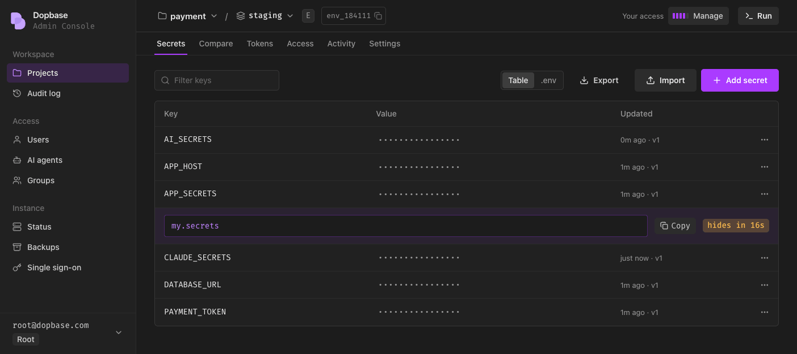

<p align="center">
  <a href="https://dopbase.com">
    
  </a>
</p>

<p align="center">
    <b>Dopbase</b>: keep .env secrets away from AI coding agent<br/>Self-hosted, open-source secrets manager for Claude Code, Cursor, and Codex users.
</p>

<p align="center">
  <a href="https://github.com/dopbase/dopbase/releases/latest"></a>
  <a href="https://github.com/dopbase/dopbase/releases"></a>
  <a href="https://github.com/dopbase/dopbase/actions/workflows/release.yml"></a>
  <a href="./LICENSE"></a>
  <a href="https://dopbase.com"></a>
  <a href="./docs/guide/quick-start.md"></a>
  <a href="./docs/guide/quick-start.md"></a>
</p>

<p align="center">
  <a href="#quick-start">Quick start</a> |
  <a href="#cli-reference">CLI reference</a> |
  <a href="#demo">Demo</a> |
  <a href="#why-dopbase">Why Dopbase</a> |
  <a href="https://dopbase.com/how-it-works">How it works</a> |
  <a href="https://docs.dopbase.com">Documentation</a> |
  <a href="./SECURITY.md">Security</a> |
  <a href="https://github.com/dopbase/dopbase/discussions">Discussions</a> |
  <a href="./CONTRIBUTING.md">Contributing</a> |
  <a href="./CODE_OF_CONDUCT.md">Code of conduct</a>
</p>

<p align="center">
  
</p>

<p align="center">
  
</p>

<p align="center">
  <sub>The Admin UI ships inside the Dopbase executable, so there is no separate frontend to deploy.</sub>
</p>

Delete the .env, run with secrets, and give agents access to only the secrets they need. Dopbase keeps application secrets organized by project and environment on infrastructure you control. Runtime data stays separate from the executable: its SQLite database, configuration, and master key live under `~/.dopbase` by default.

> [!IMPORTANT]
> **Running 0.1.10 or earlier?** There is no automatic upgrade to 0.2.0.
> Reinstalling or replacing the binary isn't enough: 0.2.0 won't start on a
> 0.1.x data directory. Back up on 0.1.x, install 0.2.0 on an empty data
> directory, and restore the backup there. Follow the
> [upgrade guide](./docs/self-hosting/upgrade-to-0-2.md) step by step.

Every push to `main` builds and publishes a `linux/amd64` container image to GitHub Container Registry at `ghcr.io/<repository>` with tags `main`, `latest`, the `package.json` version, and the short commit SHA (workflow: `.github/workflows/container.yml`). Optional native `linux/arm64` images use `.github/workflows/container-arm.yml` (manual dispatch).

## Quick start

Install the latest release on macOS or Linux and start it:

```bash
curl -fsSL https://dopbase.com/install.sh | sh
dopbase server start
```

On Windows, use PowerShell or [Git Bash](https://gitforwindows.org/) (MinGW):

```powershell
irm https://dopbase.com/install.ps1 | iex
dopbase server start
```

On fresh storage, startup prints the existing protected web setup link. Open it
to create root or restore a backup. The server continues running after setup.
An initialized instance starts normally.

To create root without browser setup, run
`DOPBASE_ROOT_EMAIL=admin@dopbase.com dopbase server start`. Save the generated
password shown once, then sign in. Later starts ignore this bootstrap input and
preserve credentials. Background startup returns credentials to the launching
command; Docker or redirected foreground output can retain them in logs.

`dopbase server setup` remains available for guided terminal setup;
`server setup --email` generates a password and exits, while
`server setup --web --email` prefills the existing browser form. With the web UI
disabled, supply a root email or complete CLI setup first. Interrupted factory
resets still require explicit setup.

The [quick-start guide](./docs/guide/quick-start.md)
covers sign-in, importing a `.env` file, and running an application with its secrets.

Native release archives are available for macOS and Linux on AMD64 and ARM64, and for Windows on AMD64.

### Install from this repository

The installers in `scripts/` download a release archive from GitHub, verify its
SHA-256 checksum, and place the `dopbase` binary on your `PATH`. They accept the
same environment variables as the hosted installers (`DOPBASE_VERSION`,
`DOPBASE_INSTALL_DIR`, `DOPBASE_REPOSITORY_URL`, and `DOPBASE_DOWNLOAD_BASE_URL`).

From a clone of this repository, the script installs a published release when the
archive exists. If a Windows archive is not published yet (for example before the
first Windows release), the installer builds from the checkout instead:

```bash
./scripts/install.sh
```

```powershell
.\scripts\install.ps1
```

Force a local build at any time:

```bash
./scripts/install.sh --from-source
```

```powershell
.\scripts\install.ps1 -FromSource
```

Without cloning, point the script at this repository (replace `main` with a
release tag or branch if needed):

```bash
curl -fsSL https://raw.githubusercontent.com/dopbase/dopbase/main/scripts/install.sh | sh
```

```powershell
irm https://raw.githubusercontent.com/dopbase/dopbase/main/scripts/install.ps1 | iex
```

Default install locations:

| Shell | Default directory |
| ----- | ----------------- |
| macOS / Linux (`install.sh`) | `~/.local/bin/dopbase` |
| Windows PowerShell (`install.ps1`) | `%LOCALAPPDATA%\Dopbase\bin\dopbase.exe` |
| Git Bash / MinGW (`install.sh`) | `%LOCALAPPDATA%\Dopbase\bin\dopbase.exe` |

On Windows, run `dopbase server start` in the foreground. Background
`server start --background`, `server stop`, and `server restart` are available
on macOS and Linux only. A Docker container is started and stopped by Docker,
not by those commands.
State still lives under `%USERPROFILE%\.dopbase` unless you set `--data-dir` or
`DOPBASE_DATA_DIR`.

## CLI reference

```text
Dopbase keeps application secrets in one binary: run a server, store secrets per project and environment, and inject them into any command with `run`.

Usage: dopbase [OPTIONS] <COMMAND>

Commands:
  server   Set up, start, stop, inspect, and read logs from a local Dopbase server
  client   Connect the CLI to a Dopbase server (`client connect <url>`)
  login    Authenticate with the active server
  logout   End the saved login on the server that issued it and remove it
  status   Alias for `dopbase client status`
  init     Create a project, its first environment, and import secrets
  project  Manage projects (create, list, show, rename, delete)
  env      Manage environments inside a project (create, clone, edit, list, rename, delete)
  secret   Manage secrets in an environment (list, set, get, delete, history, rollback)
  import   Bulk-import secrets into an environment from a dotenv, JSON, YAML, or TOML source
  export   Export secrets as dotenv, JSON, YAML, TOML, or a Docker env file
  token    Manage runner tokens for an environment, and your personal tokens
  access   Show what you, or the personal token in DOPBASE_TOKEN, can reach
  audit    Verify the integrity of the audit log (administrator only)
  run      Run a command with an environment's secrets injected as env vars
  cache    Inspect and clean the encrypted runtime cache for the active server
  admin    Offline server administration
  update   Check GitHub for a newer Dopbase release (informational only)
  backup   Create an encrypted backup snapshot of the Dopbase instance
  restore  Restore the instance from an encrypted .dop backup file
  help     Print this message or the help of the given subcommand(s)

Options:
  -v, --version
          Print the installed Dopbase version

          [alias: -V]

      --server <URL>
          Client endpoint for this invocation, overriding the saved server and DOPBASE_URL. This does not apply to local server commands

      --data-dir <DIR>
          Directory for Dopbase state and configuration

      --json
          Print machine-readable JSON instead of human-readable output, where supported

  -h, --help
          Print help (see a summary with '-h')

Quickstart:
  dopbase server setup                     # initialize the local instance once
  dopbase server start                     # start on http://localhost:8840
  dopbase server stop                      # stop the background server
  dopbase server restart                   # restart with saved launch settings
  dopbase login                            # authenticate with the active server
  dopbase init myapp/dev --from .env       # create a project + environment from a secrets file
  dopbase secret set myapp/dev API_KEY     # prompts for the value, the web UI works too
  dopbase run myapp/dev -- node server.js  # run with secrets injected as env vars

Common server options:
  --host <HOST>    Bind host (default: 127.0.0.1)
  --port <PORT>    Listen port (default: 8840)
  --no-web-ui      Disable the web UI for server start

Run 'dopbase help <command>' for details on any command.
```

Fresh instances enter automatic setup during `server start`; completed resets
use the same flow. Pending resets still require explicit setup. `init` creates
a project and its first environment; it does not initialize the server.

`server start` runs in the foreground. Add `--background` or `-b` to keep it running
in the background. `server restart` preserves launch overrides and rereads configuration.
`server up` and `server down` have been replaced by `server start --background`
and `server stop`. The old commands show an informational migration notice and
exit with status 1 without starting or stopping a server.

## Why Dopbase

`.env` files are convenient on one machine. They become difficult to track when a project has several developers, CI jobs, servers, and deployment environments. Dopbase is intended to add encrypted storage, individual secret records, access control, history, and audit events without requiring a large supporting infrastructure stack.

The model stays small:

```text
Project
  └── Environment
        └── Secrets
```

The server and client are built into the same `dopbase` executable:

```bash
dopbase server start
dopbase login
dopbase init
dopbase run payment-service/development -- npm start
```

A production build embeds the Vue Admin UI in that executable. By default, its
SQLite database, lock files, configuration, and local master key live under
`~/.dopbase`. Use `--data-dir` or `DOPBASE_DATA_DIR` to relocate them.

Read the [public documentation](./docs/) for the product model, CLI, self-hosting guidance, security design, and roadmap.

Dopbase 0.2.0 adds roles, grants and groups, so you can give people access per
project or per environment. Personal tokens let scripts and AI agents act as
their account, AI agents are accounts with an owner, and protected environments
stay closed to project-wide grants below project manager. Single sign-on and
people management are optional features, off by default. The audit log is a
hash chain that `dopbase audit verify` checks, and backups are encrypted.

See [users and AI agents](./docs/ui/users.md) and [role permissions](./docs/reference/identity.md) for how access works.
To move a 0.1.x instance to 0.2.0, follow
[Upgrade to 0.2.0](./docs/self-hosting/upgrade-to-0-2.md). Databases and backups
from before 0.1.0 are not supported.

## How it works

One executable carries the server and the client. The client authenticates,
fetches one environment, and injects its secrets straight into your application
process without writing a shared `.env` file to the runtime.

<p align="center">
  
</p>

See [server and client](./docs/guide/server-client.md) for the full walkthrough.

## How secrets are protected

- Each secret value gets its own random 256-bit data key. XChaCha20-Poly1305
  encrypts the value with that key and wraps the key with the master key. The
  environment ID, secret name, and version are authenticated with the
  ciphertext, so a value moved to another row fails to decrypt.
- The 256-bit master key lives in a file outside the database. On Unix, a key
  that Dopbase generates is readable by its owner only. Dopbase doesn't check
  the permissions of a key file you supply, so restrict that file yourself. A
  copy of the database alone doesn't reveal any values.
- `dopbase run` passes one environment to your process as environment
  variables and writes no `.env` file. `--only` narrows that to the keys you
  name. The offline cache it keeps is encrypted, and opening it needs the same
  credential that fetched it.
- An AI agent token can start at names only. It can list secret names and
  compare environments, but it is refused when it reads a value or runs a
  command with secrets. Grants go per project or per environment.
- Application logs and audit events record what happened, never the values.
  The audit log is a hash chain. `dopbase audit verify` stops at the first
  record that was edited, removed, or put out of order and reports where the
  chain breaks. Deleting the newest records leaves no break; see below.

Some things are outside what Dopbase can protect:

- Once a value is injected, the process holds it in plain text. Anything that
  can read that process's environment can read the value, including an agent
  running inside it. Scope what reaches the process with `--only` and
  per-environment grants. `--only` isn't a security boundary, though: anything
  that can use your saved login or `DOPBASE_TOKEN` can run `dopbase run` again
  without it. Keep an untrusted agent away from your Dopbase credentials and
  data directory.
- Anyone who has both the database and the master key file can decrypt every
  value. Guard the master key file as closely as the secrets themselves.
- Someone who can write the database file can rewrite the whole audit chain or
  delete its newest records, and the chain still verifies. To catch that, save
  the head sequence and hash that `dopbase audit verify` prints somewhere off
  the server and check against them later with `--anchor SEQ:HASH`, or stream
  `dopbase audit export` to storage the database writer can't change. Export
  with no filters or limit, as an account with `audit.read_all`, or the copy
  leaves out events you can't see. Records written after the saved head aren't
  covered.
- If the server is down, `dopbase run` can fall back to the cache and inject
  values that were revoked in the meantime.
- You run TLS, network access, backups, and master-key storage yourself.

Read the [security model](./docs/reference/security.md) for the full design.
The [September 2026 review](./docs/security/audits/2026-09.md) was done
internally; Dopbase has not had an independent security audit yet.

## Demo

<p align="center">
  
</p>

<p align="center">
  <a href="https://github.com/dopbase/dopbase/raw/refs/heads/main/assets/demo-dopbase-1912.mp4">See full demo (MP4 download)</a>
</p>

## Repository layout

| Path         | Purpose                                             | Current state                 |
| ------------ | --------------------------------------------------- | ----------------------------- |
| `app/`       | Rust service and command-line application           | v0.2.0 backend implementation |
| `app/tests/` | Rust integration tests                              | Backend and CLI test suite    |
| `ui/`        | Vue administration interface and its unit tests     | Embedded Admin UI             |
| `docs/`      | VitePress product documentation                     | Active public specification   |
| `e2e/`       | End-to-end tests for the CLI, REST API and Admin UI | Runs the release binary       |

## Development

You need **Bun** and a Rust toolchain with Rust 2024 edition support.

Install the JavaScript dependencies:

```bash
bun install
```

Scripts use the `action:target` pattern. The targets are `ui`, `app`, and
`docs`. Run an action without a target for the usual combined workflow.

| Command                | Purpose                                     |
| ---------------------- | ------------------------------------------- |
| `bun run dev`          | Start the Admin UI and Rust app together    |
| `bun run dev:ui`       | Start only the Admin UI development server  |
| `bun run dev:app`      | Start only the Rust API and CLI application |
| `bun run dev:docs`     | Start the documentation site                |
| `bun run build`        | Build the application and documentation     |
| `bun run build:ui`     | Build only the Admin UI                     |
| `bun run build:app`    | Build the release executable with its UI    |
| `bun run build:docs`   | Build only the documentation site           |
| `bun run test`         | Run the Admin UI and Rust application tests |
| `bun run test:ui`      | Run only the Admin UI tests                 |
| `bun run test:app`     | Run only the Rust application and CLI tests |
| `bun run test:e2e`     | Build the release binary and run e2e tests  |
| `bun run coverage`     | Run UI and app unit test coverage, UI first |
| `bun run coverage:ui`  | Run Admin UI coverage with Vitest and V8    |
| `bun run coverage:app` | Run Rust app coverage with cargo-llvm-cov   |

Coverage commands print a summary in the terminal and write an HTML report:
`ui/coverage/index.html` for the Admin UI and
`app/target/llvm-cov/html/index.html` for the Rust app. Open them with
`bun run coverage:ui:open` and `bun run coverage:app:open`. The Rust command
needs `cargo-llvm-cov` and the `llvm-tools-preview` component:

```bash
rustup component add llvm-tools-preview
cargo install cargo-llvm-cov --locked
```

`bun run dev` and `bun run dev:app` automatically enter setup on fresh storage.
Use a separate `DOPBASE_DATA_DIR` for development. Open the printed setup link or
supply `DOPBASE_ROOT_EMAIL` to generate credentials without browser setup.

The combined command serves the UI at `http://localhost:9000`, proxies `/api`
requests to the backend at `http://localhost:8840`, and stops both processes
when you press Ctrl-C. To serve the Admin UI and API from one executable, run
`bun run build:app` and then
`./app/target/release/dopbase server start`. App commands build the Admin UI
when the embedded assets are missing from a clean checkout.

See [CONTRIBUTING.md](./CONTRIBUTING.md) for the full setup, checks, and pull-request expectations.

### Rust test placement

Keep `app/src/` production-only. All Rust test cases belong under `app/tests/`
as integration tests. Do not add `#[cfg(test)]` modules, `#[test]`,
`#[tokio::test]`, or `*_test.rs` files anywhere under `app/src/`. Add or update
the corresponding test file in `app/tests/` instead. This keeps the production
source tree clean and makes the test boundary clear for both humans and AI
contributors.

## Security

Do not report vulnerabilities in a public issue. Follow [SECURITY.md](./SECURITY.md) to use GitHub private vulnerability reporting. Never include live credentials or private service details in a report, test, log, or screenshot.

## License

Dopbase is licensed under the [Apache License 2.0](./LICENSE). Attribution information is available in [NOTICE](./NOTICE).

## Community

[GitHub Discussions](https://github.com/dopbase/dopbase/discussions) is the place
to ask setup questions, share workflows, give feedback, and discuss feature ideas.
The welcome post links to tutorials with commands and terminal output.

Use [Issues](https://github.com/dopbase/dopbase/issues/new/choose) for reproducible
bugs and agreed implementation work. Report vulnerabilities privately through
[the security policy](./SECURITY.md).
