# Sign in with Keycloak

Keycloak is an open-source identity provider you can host yourself. In this
tutorial you run it in Docker on your own machine, connect Dopbase to it, and
sign in to the Admin UI as a member through Keycloak. Everything runs on
`localhost`, so you don't need a domain or a TLS certificate to follow along.
[Move to production](#move-to-production) lists what changes on a real server.

For how single sign-on works with any provider, including how accounts are
matched and what **Require single sign-on** does, see
[Single sign-on](./single-sign-on).

## How the pieces fit

Dopbase never sees the Keycloak password. The browser signs in at Keycloak,
Keycloak sends it back to Dopbase with a one-time code, and the Dopbase server
trades that code for an ID token that says who signed in.

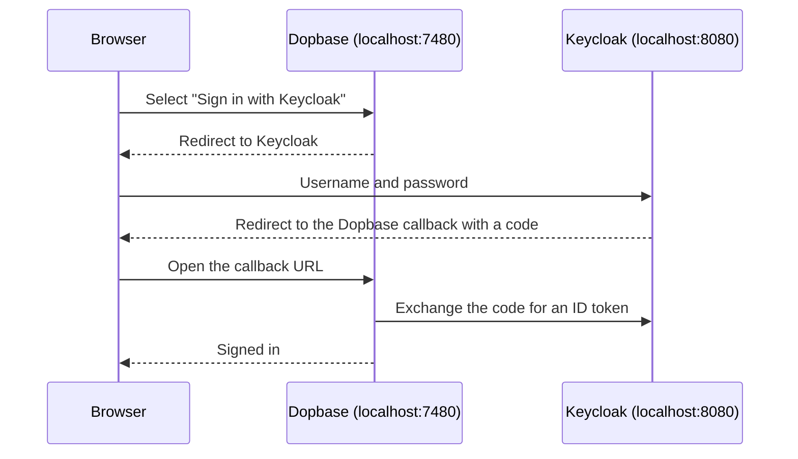

The tutorial uses these values. Keep them handy:

| What                   | Value                                            |
| ---------------------- | ------------------------------------------------ |
| Keycloak admin console | `http://localhost:8080/admin` (`admin`/`admin`)  |
| Keycloak realm         | `dopbase`                                        |
| Keycloak client ID     | `dopbase`                                        |
| Dopbase                | `http://localhost:7480`                          |
| Redirect URI           | `http://localhost:7480/api/v1/auth/sso/callback` |
| Issuer URL             | `http://localhost:8080/realms/dopbase`           |

## What you need

- Docker.
- The `dopbase` command. See the [quick start](./quick-start) to install it.
- About fifteen minutes.

This tutorial was tested with Keycloak 26.4.7, the version the command in
step 1 pins. The screenshots come from that version. Other Keycloak releases
can move menus or rename buttons, but the settings Dopbase needs are standard
OpenID Connect ones, so look for the same names.

## 1. Start Keycloak

Run Keycloak in development mode on port 8080, with `admin` as both the admin
username and password:

```bash
docker run --name keycloak -p 8080:8080 \
  -e KC_BOOTSTRAP_ADMIN_USERNAME=admin \
  -e KC_BOOTSTRAP_ADMIN_PASSWORD=admin \
  quay.io/keycloak/keycloak:26.4.7 start-dev
```

Wait for a line that ends with `Listening on: http://0.0.0.0:8080`.
Development mode uses plain HTTP and keeps its data inside the container, which
is fine for a trial and wrong for anything else.

## 2. Start Dopbase

Start a separate Dopbase instance for the trial, so it doesn't touch a real
one:

```bash
DOPBASE_ROOT_EMAIL=root@example.com dopbase server start \
  --data-dir ./dopbase-sso-demo \
  --port 7480 \
  --public-url http://localhost:7480
```

Dopbase creates the root account and prints its password once. Copy it.

Single sign-on needs an HTTPS public URL, with one exception: `localhost`. That
is why this tutorial works without a certificate. Run Dopbase directly on your
machine, not in a container. Inside a container, `localhost` points at the
container itself, so Dopbase couldn't reach Keycloak at
`http://localhost:8080`.

## 3. Create a realm in Keycloak

Open `http://localhost:8080/admin` and sign in as `admin` with password
`admin`. A realm is a separate set of users and applications. The built-in
`master` realm is for administering Keycloak itself, so make a new one:

1. Select **Manage realms**, then **Create realm**.
2. Enter `dopbase` as the **Realm name** and select **Create**.

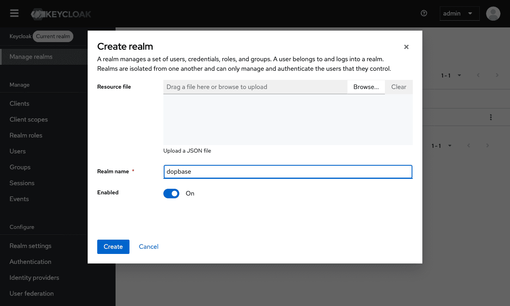

The top of the sidebar now shows **dopbase** as the current realm. Keep it
selected for the rest of the Keycloak steps.

## 4. Copy the redirect URI from Dopbase

In another tab, open `http://localhost:7480` and sign in as `root@example.com`
with the password from step 2. Open **Single sign-on** and copy the redirect
URI under **1. Register Dopbase with your provider**.

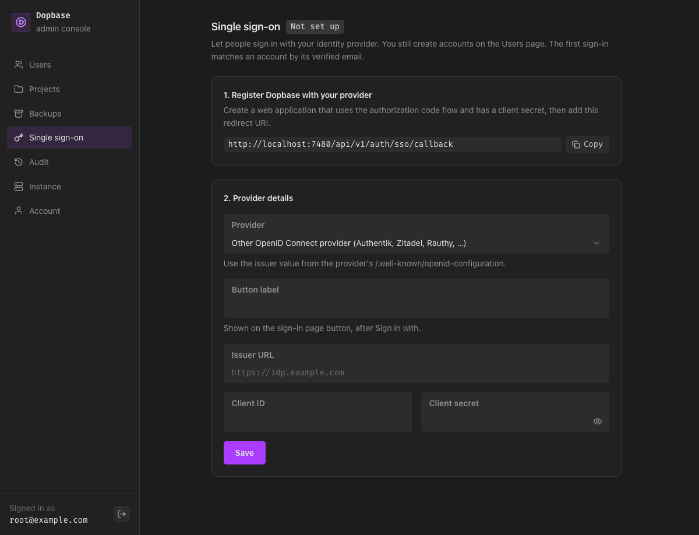

## 5. Create the Dopbase client in Keycloak

A client is how Keycloak knows about an application that signs people in. Back
in Keycloak, open **Clients** and select **Create client**. The wizard has
three pages.

**General settings.** Leave **Client type** as **OpenID Connect**. Enter
`dopbase` as the **Client ID** and `Dopbase` as the **Name**, then select
**Next**.

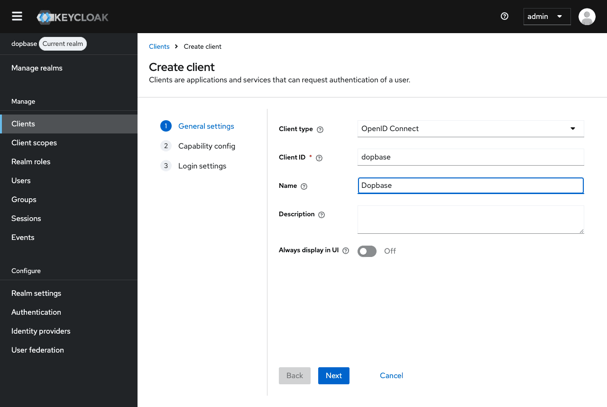

**Capability config.** Turn on **Client authentication**. This gives the client
a secret, which Dopbase needs. Leave **Standard flow** checked and the other
flows unchecked. Set **PKCE Method** to **S256**: Dopbase always sends a PKCE
challenge, so Keycloak can insist on one. Select **Next**.

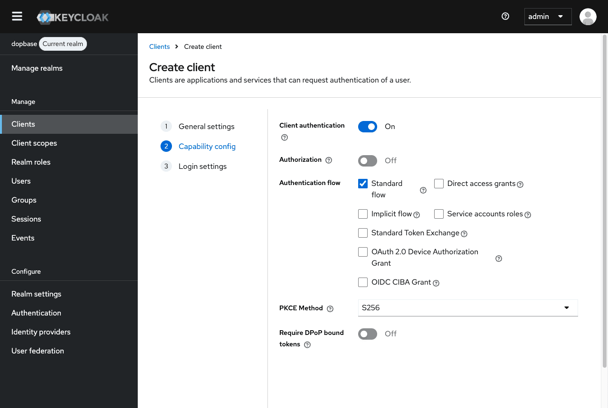

**Login settings.** Paste the redirect URI from step 4 into **Valid redirect
URIs**. Leave the other fields empty and select **Save**.

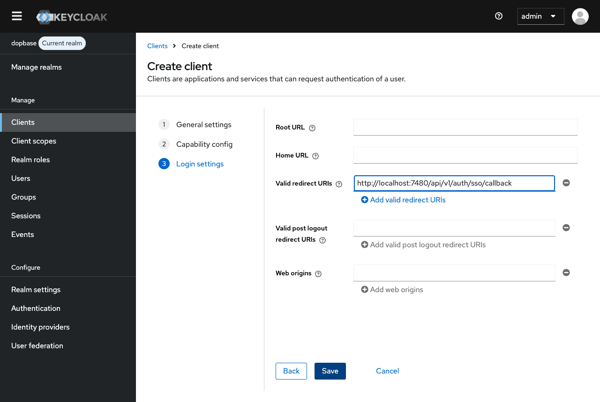

## 6. Copy the client secret

Keycloak opens the new client. Select the **Credentials** tab and copy the
**Client Secret** with the copy button next to it.

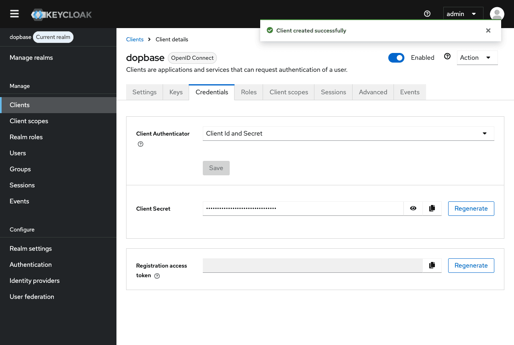

## 7. Create users in Keycloak

You need two Keycloak users: one for a member, and one for yourself as root.

Start with the member. Open **Users** and select **Create new user**:

1. Turn on **Email verified**.
2. Enter `thomi` as the **Username**, `thomi@dopbase.com` as the **Email**,
   `Thomi` as the **First name**, and `Jasir` as the **Last name**.
3. Select **Create**.

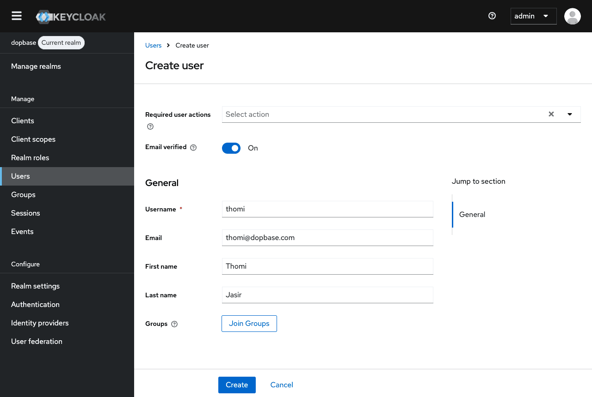

The first time Thomi signs in, Dopbase finds the account by email, and it only
trusts an email the provider marks as verified. If **Email verified** is off,
Dopbase refuses the sign-in.

Fill in both names too. Keycloak requires a first and last name by default, and
a user without them gets an "Update Account Information" form at Keycloak
before reaching Dopbase.

Give Thomi a password: open the **Credentials** tab, select **Set password**,
enter a password twice, and turn **Temporary** off so Keycloak doesn't ask for
a new one at the first sign-in. Select **Save**.

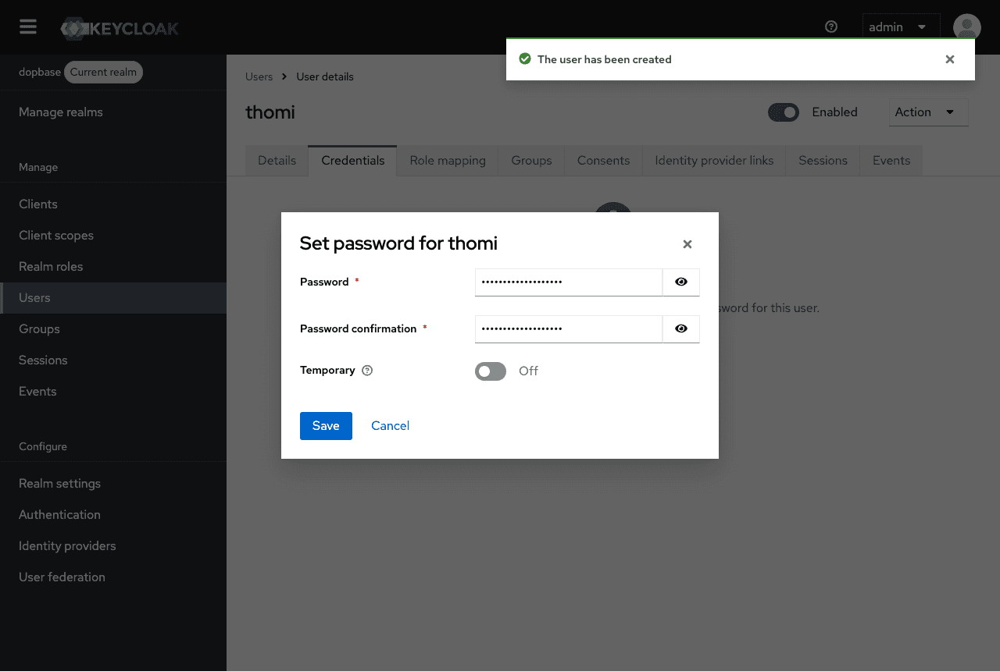

Now create a second user the same way for yourself, for example `root`, and
give it a password. You'll use it for the test sign-in in step 10. Its email
doesn't have to match the Dopbase root account: Dopbase never matches root by
email, and the test sign-in links root directly.

## 8. Create Thomi's account in Dopbase

Single sign-on only signs in people who already have a Dopbase account. In
Dopbase, open **Users** and select **Add User**. Keep the **Member** role,
enter `thomi@dopbase.com`, and give the account a password. Select **Save**.

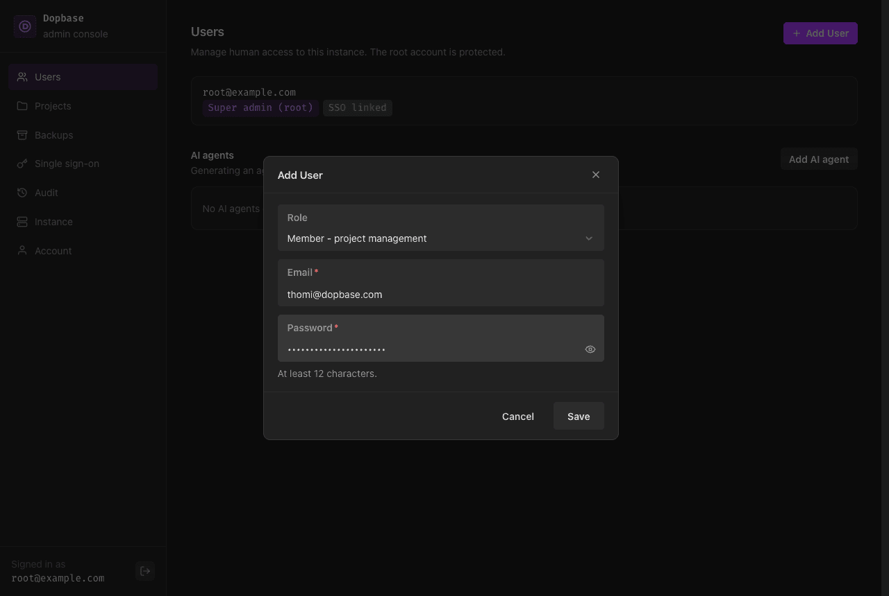

The password is required for now. Once single sign-on is on, you can leave it
empty for new accounts, and those people sign in only through Keycloak.

## 9. Enter the provider details in Dopbase

Go back to **Single sign-on** in Dopbase and fill in **2. Provider details**:

| Field         | Value                                        |
| ------------- | -------------------------------------------- |
| Provider      | Keycloak                                     |
| Button label  | `Keycloak`, filled in when you pick Keycloak |
| Issuer URL    | `http://localhost:8080/realms/dopbase`       |
| Client ID     | `dopbase`                                    |
| Client secret | The secret you copied in step 6              |

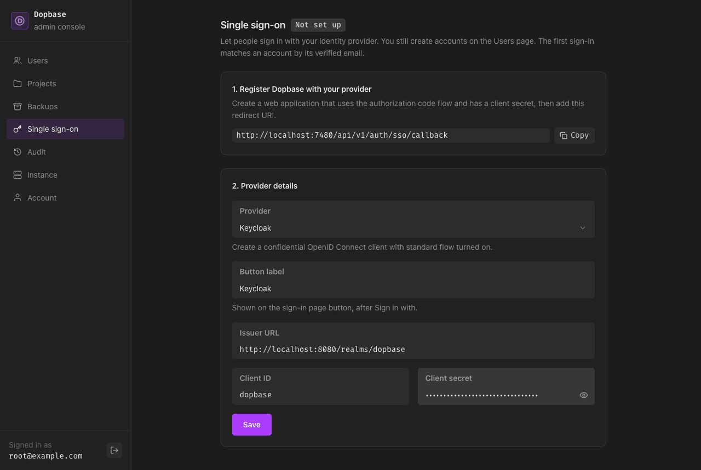

Select **Save**. Dopbase loads
`http://localhost:8080/realms/dopbase/.well-known/openid-configuration` before
it saves, so a typo in the issuer URL or realm name shows up right away.

## 10. Run a test sign-in

Under **3. Test, then turn on**, select **Test sign-in**. Dopbase sends you to
Keycloak. Sign in with the `root` Keycloak user from step 7. Keycloak sends you
back, and the page says "Test sign-in worked. You can turn on single sign-on
now." The badge next to the title changes to **Ready to turn on**.

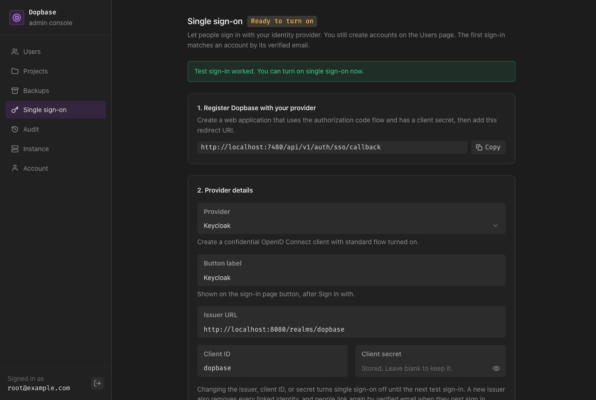

The test linked your root account to that Keycloak user and proved the client
ID, secret, and redirect URI all work.

## 11. Turn it on and sign in as Thomi

Select **Turn on**. Then sign out, or open a private window, and go to
`http://localhost:7480`. The sign-in page now has a **Sign in with Keycloak**
button above the password form.

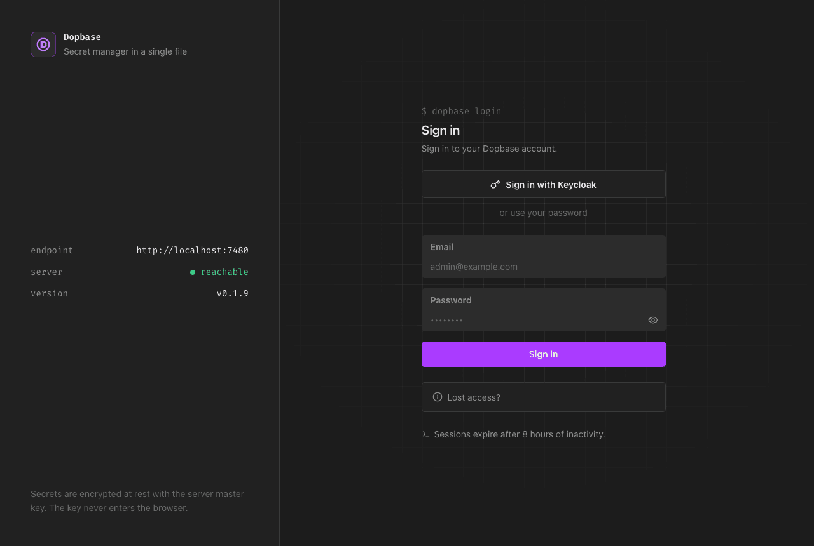

Select it. Keycloak shows its sign-in page with the realm name on top. Sign in
as `thomi` with the password from step 7.

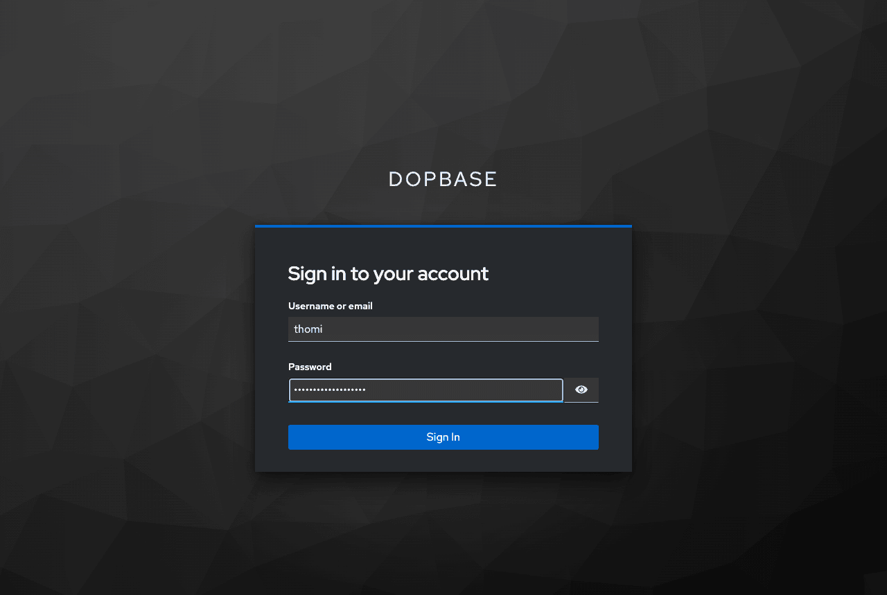

Keycloak sends you back to Dopbase, signed in as `thomi@dopbase.com` in the
member console.

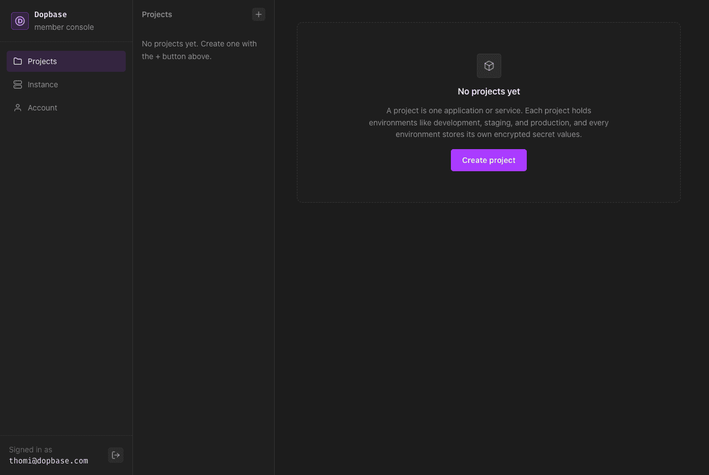

On this first sign-in, Dopbase matched Thomi by the verified email and linked
the Keycloak user to the Dopbase account. From now on it recognizes Thomi by
Keycloak's user ID, so changing the email in Keycloak won't lock anyone out.

## Move to production

The steps are the same on real servers. What changes:

- Run Keycloak in production mode with `start` instead of `start-dev`, behind
  HTTPS and with its hostname set. The issuer URL becomes
  `https://keycloak.example.com/realms/<realm>`. Outside `localhost`, Dopbase
  only accepts HTTPS issuers.
- Give Dopbase an HTTPS public URL. Its redirect URI changes with it, so add
  the new one to **Valid redirect URIs** in the Keycloak client.
- Make sure Keycloak marks emails as verified, either by sending verification
  emails or through your user federation. Dopbase can't match a user whose
  email isn't verified.

Keycloak supports `prompt=login`, so when someone confirms a sensitive action,
such as revealing a secret, Keycloak asks for their password again.

## Clean up

Stop Dopbase with Ctrl+C and delete the `dopbase-sso-demo` directory. Then
remove the Keycloak container:

```bash
docker rm -f keycloak
```

## Troubleshooting

- **Keycloak shows "Invalid parameter: redirect_uri".** The redirect URI in
  the client's **Valid redirect URIs** doesn't match the one on the Dopbase
  Single sign-on page. Copy it again, including the port.
- **Keycloak asks to "Update Account Information" after the password.** The
  user is missing a field the realm requires, usually the last name. Fill it
  in on that form or on the user's **Details** tab in Keycloak.
- **Saving in Dopbase fails before anything opens.** Dopbase couldn't load
  Keycloak's discovery document. Check that the container is running and open
  `http://localhost:8080/realms/dopbase/.well-known/openid-configuration` in a
  browser. A wrong realm name gives a 404.
- **"Enter the provider's HTTPS issuer URL."** The issuer uses `http://` with
  a host other than `localhost`. Use HTTPS, or run both servers on `localhost`.
- **"Your identity provider hasn't verified that email…"** Turn on **Email
  verified** for that user in Keycloak.
- **"No Dopbase account uses that email."** The email on the Keycloak user
  doesn't match any Dopbase account. Create the account on the Users page, or
  fix the email in Keycloak.
- **"Single sign-on didn't work."** This usually means a wrong client secret,
  or **Client authentication** is off in Keycloak. Copy the secret from the
  **Credentials** tab again, save, and run **Test sign-in**. The
  [audit log](/reference/audit-events) records each failure as
  `sso_login.failed` with a reason.
